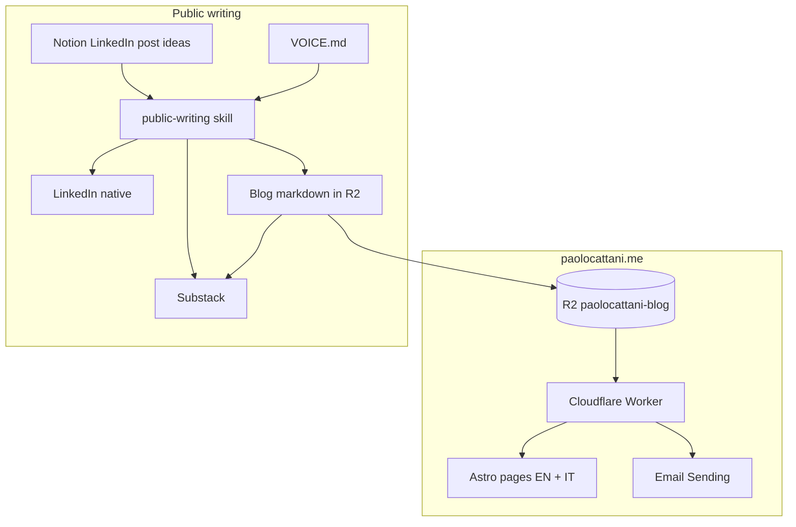

# Architectural Memory Map

**Last updated:** 2026-11-05

How this site and the public-writing system work. Operational status lives in [docs/STATUS.md](../STATUS.md).

## High-level architecture

## Knowledge files

| File | Purpose |
|------|---------|
| This file | Map and file index |
| [ADR.md](ADR.md) | Why the writing and site choices are this way |
| [VOICE.md](VOICE.md) | Public voice. Source of truth for style |
| [CHANNELS.md](CHANNELS.md) | LinkedIn, blog, Substack: what each one is for |
| [SERIES.md](SERIES.md) | Current series, titles, publish order |

## Site facts the writing system must not fight

- Blog posts are Markdown in R2 under `posts/`, fetched at runtime. No rebuild to publish.
- `/blog` and `/en/blog` list the same `posts/` prefix. There is no locale split yet.
- Frontmatter: `title`, `date` (`YYYY-MM-DD`), `description`. Optional: `lang`, `series`, `series_index`.
- LinkedIn profile: `https://www.linkedin.com/in/paolo-cattani`
- Giova is already named on the home page. Customer names are not.
- The contact form is `POST /api/contact`. The Worker sends from `contact@paolocattani.me` to `paolocattani0501@gmail.com` through the `EMAIL` binding. No Formspree.
